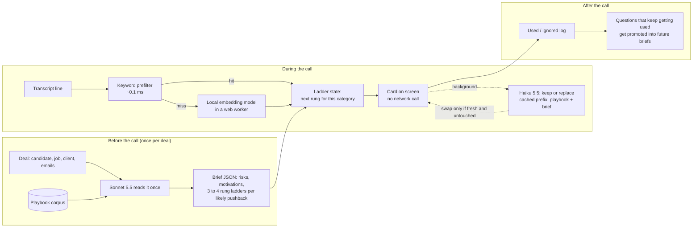

# Caddy Lab

A prototype exploring live call coaching for agency recruiters. The question it answers: how do you get nuanced, deal-specific questions on screen in well under half a second without paying for a big model on every line?

The idea is to do the expensive thinking before and after the call, so the live path is fast and cheap.

> Prototype exploring live call coaching. Mock data. The playbook in `/playbook` is invented and stands in for a real best-practice corpus.

## The answer in one line

Spend tokens on the corpus once, not on every line of every call.

1. **Once, overnight.** Batch-read every deal and every playbook doc. Haiku pulls the moments out of each deal (the pushback, the question asked, what happened next); Sonnet turns each doc into situations and question ladders. At about 60,000 deals and 3,000 docs that's roughly $32 with the Batch API (see `corpusPassCost` in `lib/cost.ts`).
2. **Before each call.** Sonnet picks the slice of that corpus that matches this deal and writes its follow-up questions, each with what happened in similar past deals.
3. **During the call.** Local matching, no model. Haiku only sharpens a question when the candidate pushes back.
4. **After the call.** What recruiters actually ask (detected from the transcript, no clicks) and how deals end feed back into what gets prepared next time.

The unique part is joining the two halves of the corpus: the playbook says what good recruiters ask, the deal history says what actually worked.

## How it works



**Fast path.** Each candidate line runs through a keyword prefilter (regex signals per pushback category). If that misses and the in-browser MiniLM model is warm, it compares the line to category exemplars. Either way, no API call. The card comes from the brief's ladder for that category. A category climbs a rung only when it comes up again after the recruiter has spoken, which is how the second, third and fourth "dig deeper" questions get served from cache.

**Slow path.** Haiku gets the last 4 lines, the current suggestion and the names of the 4 most relevant playbook files (TF-IDF, or embeddings when warm). It returns `keep` or `replace`. A replacement swaps in only if it lands within 3 seconds, nobody has clicked the card, and it's still the newest card. Otherwise it shows as a chip so text never moves under the recruiter's eyes.

**Caching.** The prompt prefix is `system → full playbook → this deal's brief`, with cache breakpoints after the playbook and the brief. The playbook block is byte-identical across every call and deal. Cache reads on Haiku 5.5 are $0.01 per million tokens.

**Mock mode.** On by default. Precomputed briefs and canned refinements, with a fake 650 to 1050 ms Haiku round trip so the swap logic is exercised. Live mode needs `CADDY_LIVE=1`, `ANTHROPIC_API_KEY` and the `CADDY_PASSCODE` typed into the header. If any live call fails, the app falls back to mock data rather than breaking.

## Cost math

Prices (USD per million tokens, from the [Anthropic pricing page](https://platform.claude.com/docs/en/about-claude/pricing), checked November 17, 2026), all in `lib/config.ts`:

| Model | Input | Output | Cache write (5 min) | Cache read |
|---|---|---|---|---|
| Sonnet 5.5 | 2.00 | 10.00 | 2.50 | 0.10 |
| Haiku 5.5 (prompts up to 100k) | 0.10 | 0.50 | 0.125 | 0.01 |
| Opus 5.5 (naive option) | 4.00 | 20.00 | 5.00 | 0.20 |

Defaults: 240 utterances per hour, 30 minute calls, 25% of lines trigger a refinement.

**Naive** (Sonnet on every line with system + full playbook + raw deal + transcript so far):
`240 × (prefix + avg transcript) × input + 240 × 120 × output`
With mock-mode token estimates (prefix 7.4k, 20 tokens a line) that's about **$4.41 per call hour**, or **$1.08** if you give naive prompt caching too.

**Caddy Lab:** one Sonnet brief per call (~2.1k in, 1.4k out, so $0.018 each, $0.036 per hour) plus 60 Haiku refinements on an 8.1k cached prefix (~$0.010 per hour). Fast path is $0. About **$0.046 per call hour**.

That's ~95x cheaper than uncached naive and ~23x cheaper than cached naive. Most of what's left is the brief, which is the right place to spend.

In live mode, `/api/tokens` uses Anthropic's token counting endpoint so both sides use measured sizes, and every real API response's `usage` object feeds the session spend on `/cost`.

## Running it

```bash
npm install
npm run dev          # builds the playbook index, then starts Next
npx tsx --tsconfig tsconfig.json scripts/simulate.ts   # dry run both scenarios in the terminal
```

Env vars for live mode (Vercel project settings):

```
ANTHROPIC_API_KEY=sk-ant-...
CADDY_LIVE=1
CADDY_PASSCODE=something-only-you-know
```

## Layout

```
app/            page.tsx (call), cost/page.tsx, api/{brief,refine,tokens,status}
components/     CallScreen, SuggestionCard, BriefPanel, LearningLoop, Header
lib/            config, schemas, fastpath, engine (ladder logic), retrieval, cost, prompts, embeddings
data/           categories, deals, transcripts, mock/{briefs,refinements}
playbook/       34 mock playbook files
docs/           Talking points for the next call
```

## What this doesn't prove

- **The data is mock.** 34 invented playbook files and two deals, versus a real corpus of thousands of docs and 60k deals. Retrieval quality at that size is a different problem.
- **No real speech-to-text.** Lines arrive clean and complete. Real STT gives partial, wrong and overlapping text, and its own latency is likely most of a 0.4 second budget.
- **The keyword prefilter is hand-tuned to these scripts.** It shows the shape of a zero-cost classifier, not its accuracy. A real one would be trained on labeled call lines from the corpus.
- **The outcome numbers are invented.** "71% accepted when asked" and "built from 1,284 similar deals" show where real deal-history stats would appear. They aren't computed from anything.
- **Mock refinements are canned.** They show the swap behavior, not Haiku's judgement. Live mode exercises the real thing.
- **Embedding classifier is untested at scale here.** The build sandbox couldn't download the model, so keywords carried the demo; the model loads in a normal browser.
- **Cost numbers are per call hour under stated assumptions.** Utterance rate, pushback share and call length are guesses you can edit on `/cost`.
- **"Magic" isn't measured.** Used/ignored is a proxy. Whether a question changed the outcome of a deal is the real metric and needs deal data after the call.
